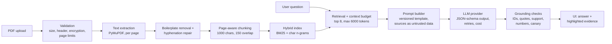

# Architecture

DocIntel AI is a single-process Python application: a Streamlit user interface on top of a small,
framework-free package (`src/docintel`). There is no database, vector store, agent framework or
background service. Everything a user uploads lives in that browser session's memory.

## 1. Pipeline

Summaries and extraction skip retrieval: they walk the whole document section by section
(map-reduce for summaries) and report page coverage. Comparison allocates the context budget evenly
across the selected documents.

## 2. Modules

| Module | Responsibility |
|---|---|
| `config.py` | `Settings` from `DOCINTEL_*` environment variables (validated, frozen); API keys read on demand as `SecretStr`, never stored on settings |
| `model_catalog.py` | The only place model IDs and prices live; cost estimation |
| `models.py` | Pydantic records (documents, pages, chunks, source passages) and the strict LLM output schemas |
| `security.py` | Prompt-injection heuristics, filename/inline sanitization, delimiter neutralization, safe error messages, logging policy |
| `pdf_processing.py` | Upload validation, in-memory extraction, normalization, boilerplate removal, page rendering with highlights |
| `chunking.py` | Deterministic page-bounded chunks with exact character offsets and a document-title search header |
| `retrieval.py` | Tokenizer/stemmer, BM25, character n-gram TF-IDF, hybrid RRF, context selection |
| `prompting.py` | Loads `prompts/*.md`, single-pass placeholder rendering, `<source>` block formatting, conversation history |
| `llm_client.py` | Provider interface; OpenAI, Anthropic, Gemini adapters; scripted provider; retries, budget, usage and cost |
| `offline_provider.py` | Deterministic extractive baseline used without an API key and as an evaluation baseline |
| `grounding.py` | Citation validation and the grounding report/verdict |
| `qa.py`, `summarization.py`, `extraction.py`, `comparison.py` | Task workflows |
| `workflow_utils.py` | Section planning, coverage reports, pre-flight cost plans |
| `session.py` | `DocumentWorkspace`: one user's documents, chunks and indexes |
| `app.py` | Streamlit interface |

Dependencies point one way: workflows depend on the pipeline modules, never the reverse, and only
`llm_client.py` imports provider SDKs (lazily, so optional providers need not be installed).

## 3. Grounded question answering in detail

1. **Validate** the question (non-empty, at most 2,000 characters) and the document scope.
2. **Retrieve.** For follow-up questions the previous question is appended to the search query so
   references like "the second one" find the right passages. The hybrid retriever returns up to 24
   candidates.
3. **Select context.** Highest-ranked chunks are added until 8 passages or ~6,000 estimated tokens;
   near-duplicate overlapping chunks are skipped; with several documents in scope, at most 5 passages
   per document keep one long document from crowding out the others.
4. **Assign source IDs** `S1..Sn` for this request only. If nothing matched at all, the workflow
   returns "insufficient evidence" without calling the model.
5. **Build the prompt.** Trusted rules go only in the system message. The user message contains the
   (unverified) conversation history, the document list, the passages in `<source id= document= page=>`
   blocks, and the question. Document text cannot close or forge a `<source>` block, and placeholder
   substitution is single-pass so document text is never re-interpreted as a template.
6. **Generate.** The provider requests JSON matching `QAOutput`. The shared client enforces the
   per-session request budget, retries transient failures (rate limits honoring `Retry-After`,
   timeouts, connection and server errors) with capped exponential backoff, retries once on
   schema-invalid output, and records tokens, latency and cost.
7. **Check grounding** (`grounding.validate_qa`): every cited ID must have been provided; every quote
   is matched against its passage (exact, approximate >= 0.85 word similarity, or not found); a
   heuristic support score compares the claim's content words and numbers with the cited passages;
   numbers in the answer that appear in no source are listed; the prompt canary is scanned for. The
   report produces a verdict: `grounded`, `review`, `unsupported` or `abstained`.
8. **Display** the answer with citation chips, status, conflicts, missing information and inferences,
   and an evidence panel with the cited passages, the quoted words highlighted and a "View page"
   button that renders the PDF page with the quote highlighted.

## 4. Key design decisions

| Decision | Rationale |
|---|---|
| Lexical/hybrid retrieval, no embeddings or vector DB | Deterministic, offline, free, explainable; measured on paraphrased questions (see evaluation). Embeddings are the documented next step for vocabulary mismatch. |
| Chunks never cross pages | Every citation maps to exactly one page. Cost: a sentence split across a page break is split between chunks. |
| Request-scoped IDs (`S1`...) instead of internal chunk IDs | Short, easy for the model to copy, and any ID outside the provided set is detectably fabricated. |
| Verbatim quotes in the output schema | Makes citation support machine-checkable instead of trusting that a cited ID supports a claim. |
| Strict schemas without defaults | Satisfies OpenAI strict mode, Anthropic and Gemini with one set of Pydantic models. |
| Own retry loop, SDK retries disabled | One bounded, testable retry policy for all providers. |
| `store=false` on OpenAI | The Responses API stores responses by default. |
| Offline extractive provider | The app and the full test/evaluation pipeline work without a key; gives a baseline to beat. |
| In-memory processing only | No temporary files to clean up; nothing persists after the session. |
| No `st.cache_data` / `st.cache_resource` for documents | Those caches are shared across all sessions; documents must not be. |

## 5. Session isolation and state

Streamlit runs one script execution per browser session; `st.session_state` is per session. The app
creates exactly one `DocumentWorkspace` per session and stores uploads, chunks, indexes, chat history,
ratings and rendered page images there. `tests/test_app.py` runs two independent AppTest sessions and
asserts that documents loaded in one are invisible in the other. This is session isolation for a
single-server prototype; it has not been tested as a multi-tenant production deployment (no
authentication, quotas or audit logging).

## 6. Error handling

| Failure | Behaviour |
|---|---|
| Invalid, corrupt, encrypted, empty, oversized, too-long or scanned PDF | Rejected with a specific explanation (`PDFValidationError.user_message`) |
| Page that fails to extract / has no text | Kept as an empty page, listed in the document's warnings |
| Missing API key | UI falls back to the offline provider and says so; the evaluation runner refuses to run |
| Rate limit, timeout, connection or server error | Bounded retries, then a plain-language error |
| Authentication, quota, bad request, unknown model | No retry; specific message |
| Schema-invalid or truncated output | One retry, then an error; never displayed as an answer |
| Model refusal | Reported as a refusal |
| Any other exception | Generic message; exception type logged; no stack trace (also enforced by `client.showErrorDetails = "none"`) |

## 7. Extending

* **New provider:** subclass `LLMProvider`, implement `_call`, add prices to `model_catalog.py`.
* **New retriever (e.g. embeddings):** subclass `_BaseRetriever`, register it in `RETRIEVERS`; the
  retrieval benchmark picks it up automatically.
* **New prompt version:** add `prompts/grounded_qa_v3.md`, register it in `prompting.QA_PROMPTS`, run
  the evaluation for both versions and compare with `evaluation.compare_runs`.
